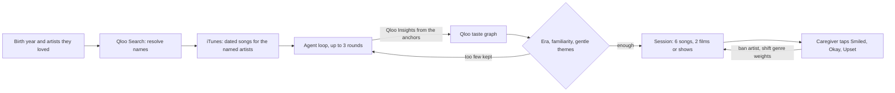

<p align="center"></p>

<h1 align="center">Memory Lane</h1>

<p align="center"><strong>The right song isn't the popular one. It's the one from when they were 19.</strong></p>

<p align="center">
  <a href="https://memory-lane.encore-tanishmisra9.workers.dev">Live demo</a> ·
  <a href="docs/evaluation.md">Evaluation</a> ·
  <a href="docs/submission-draft.md">Write-up</a>
</p>

<p align="center">
  <a href="https://github.com/tanishmisra9/memory-lane/actions/workflows/ci.yml"></a>
  
  
</p>

**Try it: https://memory-lane.encore-tanishmisra9.workers.dev** (no login; "Greece, 1947" on the landing page is a one-tap example).

Memory Lane helps a family caregiver run a short music-and-memories session with someone who has dementia, then keep what came of it.

1. **Landing.** One idea, one button.
2. **Setup.** Three short questions: a first name (optional), the year they were born, and one to three artists they loved (autocomplete from Qloo, or a starter shelf for 12 countries).
3. **Tuning.** The real agent trace streams in live: what it asked Qloo, how many artists it kept and set aside, and the cultural reading Qloo draws from the artists you named (scenes, influences).
4. **Player.** One song at a time, full screen: cover art, an era timeline that shows where the song sits in their life, a 30-second preview, and Smiled / Okay / Upset. Smiled and Okay open a one-line note. Upset swaps the song for another. "Why this" shows where it came from, its cultural thread (scene, influences, origin, and how close each named artist sits to it, from Qloo's explainability), and what was checked.
5. **Memory Book.** What comes out: what worked, what to avoid and what is neutral for family and care staff, their cultural profile, the words you wrote, every song on one timeline of their years, and links to keep playing in Spotify or Apple Music. Print it, share the link, or delete it.

Built for the [Qloo Agentic Hackathon](https://qloo.devpost.com/). It started as a Discord planner (still on the [`v1-discord`](https://github.com/tanishmisra9/memory-lane/tree/v1-discord) branch) and was rebuilt as a web app judges can use directly.

## How it works



| Decision | Owner | Guardrail |
| --- | --- | --- |
| Which artists, films and shows are near what they loved | Qloo Insights, Search | A Qloo failure is shown, never replaced by a generic list |
| Which are from their youth (born +10 to +30) | Code | Unknown start year is excluded |
| Which are familiar and gentle | Code | Obscure, complex, or upsetting lyrical themes are removed |
| Whether a song can be played | iTunes preview match | Artist name must match; songs without audio are swapped out |
| What to do after a reaction | Code | Upset bans the artist; weights stay within 0.25 to 2 |
| Conversation prompts | Fixed templates | Filled from real titles; nothing is generated |

No language model is involved anywhere. The agent loop queries Qloo, filters by era and safety in code, re-anchors on artists it has not used yet, and repeats until it has 15 safe artists or three rounds. The trace is under "How it chose" on the page.

**Limits.** Qloo has no per-song data, so songs from found artists show the ages the artist was active, not a release year (named artists get exact years from iTunes). About 4% of songs lack a preview. Films and shows are weaker matches than music. It is not therapy and makes no medical claims.

## Run it

```sh
npm install
echo "QLOO_API_KEY=<hackathon key>" > .dev.vars
npx wrangler d1 migrations apply memory-lane --local
npm run build          # web/ -> dist/
npm run dev            # Worker + built app at http://localhost:8787
npm run web            # optional: Vite dev server on :5173, proxying /api to :8787
```

```sh
npm run check          # TypeScript for the Worker and the web app
npm test               # 27 unit tests, offline
npm run e2e            # the whole product in real Chrome, desktop and mobile
npm run eval           # three-arm evaluation on eight personas (live Qloo)
```

`BASE_URL=https://memory-lane.encore-tanishmisra9.workers.dev npm run e2e` runs the same test against production. It walks landing, setup, the live trace, the player (audio plays, the progress moves), keyboard control, the Why drawer, an Upset swap, a note, the finish screen, the Memory Book, reload, and delete. It also fails on any rounded shape above 8px, any control under 44px tall, sideways scrolling, or a console error. It uses installed Chrome when present so audio is real.

Stack: a Cloudflare Worker (`src/`) with D1, and a Vite + React + framer-motion front end (`web/`) served as static assets with `/api/*` going to the Worker first. Deploy with `npx wrangler d1 create memory-lane`, put the id in `wrangler.jsonc`, `npx wrangler d1 migrations apply memory-lane --remote`, `npx wrangler secret put QLOO_API_KEY`, `npm run build && npm run deploy`.

## Privacy

A birth year, up to three artist names, an optional first name, and the one-line notes you choose to write. No health data, no accounts, no location. Sessions expire after 30 days and can be deleted from the Memory Book. Qloo responses are cached privately on the server and are not stored in this repository.

## License

[MIT](LICENSE)
