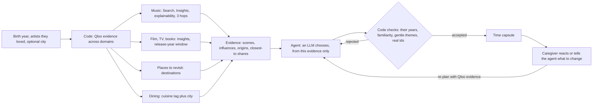

<p align="center"></p>

<h1 align="center">Memory Lane</h1>

<p align="center"><strong>The right song isn't the popular one. It's the one from when they were 19.</strong></p>

<p align="center">
  <a href="https://memory-lane.encore-tanishmisra9.workers.dev">Live demo</a> ·
  <a href="docs/evaluation.md">Evaluation</a> ·
  <a href="docs/submission-draft.md">Write-up</a>
</p>

<p align="center">
  <a href="https://github.com/tanishmisra9/memory-lane/actions/workflows/ci.yml"></a>
  
  
</p>

**Try it: https://memory-lane.encore-tanishmisra9.workers.dev** (no login; "Greece, 1947" on the landing page is a one-tap example).

Memory Lane helps a family caregiver run a short music-and-memories session with someone who has dementia, then keep what came of it.

1. **Landing.** One idea, one button.
2. **Setup.** Three short questions: a first name (optional), the year they were born, and one to three artists they loved (autocomplete from Qloo, or a starter shelf for 12 countries).
3. **Tuning.** The real agent trace streams in live: what it asked Qloo, how many artists it kept and set aside, and the cultural reading Qloo draws from the artists you named (scenes, influences).
4. **Player.** One song at a time, full screen: cover art, an era timeline that shows where the song sits in their life, a 30-second preview, and Smiled / Okay / Upset. Smiled and Okay open a one-line note. Upset swaps the song for another. "Why this" shows where it came from, its cultural thread (scene, influences, origin, and how close each named artist sits to it, from Qloo's explainability), and what was checked.
5. **Memory Book.** What comes out: what worked, what to avoid and what is neutral for family and care staff, their cultural profile, the words you wrote, every song on one timeline of their years, and links to keep playing in Spotify or Apple Music. Print it, share the link, or delete it.

Built for the [Qloo Agentic Hackathon](https://qloo.devpost.com/). It started as a Discord planner (still on the [`v1-discord`](https://github.com/tanishmisra9/memory-lane/tree/v1-discord) branch) and was rebuilt as a web app judges can use directly.

## How it works



Qloo is used across the whole brief: **Search** (name-checked), **Insights** over artists, movies, TV, books, destinations and places, with **explainability** (how close each result sits to each named artist), **release- and publication-year filters**, **location and cuisine tags** for dining, and the culture carried in artist properties and tags (scenes, influences, origin, how listeners are described). Every call is checked against a per-type parameter allowlist, because Qloo silently ignores a parameter that does not apply.

### Request to result

One session, as the Worker runs it. I call the Qloo API directly from the Worker, on the hackathon host, not through the harness or MCP. The key stays server-side.

1. **Search** (`/search`, `types=urn:entity:artist`) resolves each artist the caregiver named. Search is fuzzy, so a result is accepted only when its name agrees with the one typed (equal, or one contains the other); otherwise the artist is reported as not found.
2. **Insights over artists** (`/v2/insights`, `filter.type=urn:entity:artist`, `signal.interests.entities` = the named ids, `feature.explainability=true`) returns nearby artists with their active years, familiarity, lyrical themes, notable songs, and the scene, influences and origin that become the cultural profile. Artists that fit the person's years and pass the safety rules become the next signals, for up to three rounds.
3. **Insights per domain**, using the named artists plus up to four found ones as signals. Films and TV take `filter.release_year` (birth year plus 10 to 30), books take `filter.publication_year`, destinations take signals only. Each call carries explainability, which gives the "closest to" shares shown in the Why drawer.
4. **Dining** (only if a city is given): `/v2/tags` finds a cuisine tag from the culture Qloo returned (for example "Greek"), and Insights for `urn:entity:place` takes `filter.location.query` (the city) and `filter.tags` (that tag).
5. Every call is checked against a per-type parameter allowlist (`src/domains.ts`), because Qloo silently ignores a parameter that does not apply.
6. The agent then chooses only from those results, and code checks years, familiarity, themes and audio before anything plays.

What Qloo receives: artist names, entity ids, year ranges, and the city if given. Never the first name or the notes.

The agent (Workers AI, `gpt-oss-120b`) never invents anything: it sees only what Qloo returned, and `submit_plan` is rejected in code if a song is outside their years, unfamiliar, has upsetting lyrical themes, or if any id did not come from Qloo. Books, films and shows are screened for violence, war and tragedy too. If the model is unavailable, the closest Qloo result in each domain is used, and the Memory Book says so.

| Decision | Owner | Guardrail |
| --- | --- | --- |
| What is near what they loved, across cultures and domains | Qloo | A Qloo failure is shown, never replaced by a generic list |
| Which of those to pick, and why | LLM agent | Only ids Qloo returned; rejected and retried otherwise |
| Their years, familiarity, gentle themes, audio, duplicates | Code | Unknown start year is excluded; unsafe is never played |
| What to do after a reaction or an instruction | Code + agent | Upset bans the artist; "tell the agent" re-plans from Qloo evidence |
| Whether to go, what to eat, who to call | The caregiver | Nothing is booked or sent |

**Limits.** Qloo has no per-song data, so songs from found artists show the ages the artist was active (named artists get exact years from iTunes). Film and TV picks are better than book picks; destinations suit some cultures better than others. The agent runs on Cloudflare's Workers AI free allowance (10,000 neurons a day); past that the app falls back to the Qloo ranking and says so. Qloo describes what groups of people tend to like, not what one person will do, so the caregiver decides what to play. It is not therapy and makes no medical claims.

## Run it

```sh
npm install
echo "QLOO_API_KEY=<hackathon key>" > .dev.vars
npx wrangler d1 migrations apply memory-lane --local
npm run build          # web/ -> dist/
npm run dev            # Worker + built app at http://localhost:8787
npm run web            # optional: Vite dev server on :5173, proxying /api to :8787
```

```sh
npm run check          # TypeScript for the Worker and the web app
npm test               # 32 unit tests, offline
npm run e2e            # the whole product in real Chrome, desktop and mobile
npm run eval           # three-arm evaluation on eight personas (live Qloo)
```

`BASE_URL=https://memory-lane.encore-tanishmisra9.workers.dev npm run e2e` runs the same test against production. It walks landing, setup, the live trace, the player (audio plays, the progress moves), keyboard control, the Why drawer, an Upset swap, a note, the finish screen, the Memory Book, reload, and delete. It also fails on any rounded shape above 8px, any control under 44px tall, sideways scrolling, or a console error. It uses installed Chrome when present so audio is real.

Stack: a Cloudflare Worker (`src/`) with D1, and a Vite + React + framer-motion front end (`web/`) served as static assets with `/api/*` going to the Worker first. Deploy with `npx wrangler d1 create memory-lane`, put the id in `wrangler.jsonc`, `npx wrangler d1 migrations apply memory-lane --remote`, `npx wrangler secret put QLOO_API_KEY`, `npm run build && npm run deploy`.

## Privacy

A birth year, up to three artist names, an optional first name, an optional city (for a restaurant near them; a city name, never an address), and the one-line notes you choose to write. No health data, no accounts. Qloo receives the artist names, release-year ranges worked out from the birth year, and the city if given; it never receives the first name or notes. What you type in Tell the agent goes to the agent (Cloudflare Workers AI), not to Qloo. Sessions expire after 30 days and can be deleted from the Memory Book. Qloo responses are cached privately on the server and are not stored in this repository.

## License

[MIT](LICENSE)
